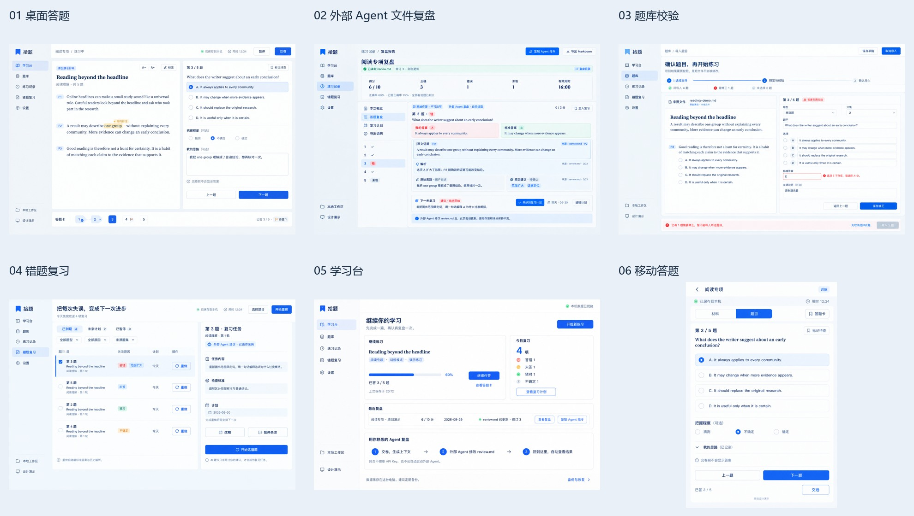

# 拾题 · Shiti Workbench

> 个人答题与**外部 Agent 文件复盘**工作台。本轮交付规划、规格、协议样本和设计原图，**本轮不执行产品开发**。

## 核心体验

**做题交卷 → 生成 context.md → 在 CC / 其他 Harness 中要求复盘 → Agent 修改 review.md → 网页自动读取并可视化 → 用户采纳复习建议。**

网页不内置AI聊天、不接模型SDK、不收集API Key，也不要求用户手工复制粘贴AI回复。

## 推荐阅读顺序

1. [产品白皮书](WHITEPAPER.md)：目标、已知需求、假设、完整功能和阶段。
2. [六页设计总览](design/contact-sheet.jpg)：快速看最终界面方向。
3. [外部Agent文件协议](docs/05-外部Agent文件协议.md)：核心文件格式、监听、刷新、冲突与历史。
4. [执行Agent交接说明](AGENT_HANDOFF.md)：开发顺序、禁止项、验收要求。
5. [完整报告样本](examples/完整复盘报告-演示.md)：独立可读的详细Markdown。
6. [可编辑复盘样本](examples/agent-workspace/attempts/demo-attempt-001/review.md)：Agent真正应修改的文件长什么样。

## 规格与样本

| 文档 | 内容 |
|---|---|
| [01 交互与页面](docs/01-交互与页面规格.md) | 页面、操作、状态、错误文案、键盘、手机 |
| [02 数据与接口](docs/02-数据与接口契约.md) | 实体、判分、计时、快照、保存、HTTP |
| [03 Markdown报告](docs/03-Markdown与AI复盘协议.md) | context/review/report分工、详细报告、导出安全 |
| [04 生产质量](docs/04-生产质量与验收.md) | 安全、备份恢复、性能、测试与发布门槛 |
| [05 外部Agent文件](docs/05-外部Agent文件协议.md) | 文件驱动复盘的完整P0契约 |
| [视觉规范与选样](design/README.md) | 六张最终原图、Token、迭代和已知偏差 |
| [review.schema.json](specs/review.schema.json) | review.md的YAML元信息Schema |
| [建议摘要测试向量](specs/suggestion-hash-vectors.json) | 建议变更后重新确认的确定性规则 |
| [外部Agent工作区示例](examples/agent-workspace/AGENTS.md) | Harness说明与context/review/state演示 |
| [交付核验记录](docs/06-交付核验记录.md) | 本次实际检查与尚未开发的边界 |

## 最终原图

最终六张单页图位于`design/final/`；三张早期稿位于`design/candidates/`。复盘页采用`02-report-files-v3-1.png`，不是候选中的旧版。

## 当前状态与边界

- 独立项目目录已创建，Git已初始化main。
- 本次不创建远端、不commit、不push；初始化不等于提交。
- 本轮没有安装产品依赖、搭脚手架或启动产品服务。核验时目录中出现了非本轮创建的`apps/`、`packages/`、`package.json`、依赖等开发内容；来源未核实，未删除或验证，不在本轮交付验收范围内。
- 示例均为原创虚构数据；没有读取/迁移上级目录中的真实题库、笔记或敏感配置。
- 外部Agent示例是离线格式演示，编辑后**目前不会**自动更新网页或state；监听器留给未来开发实现。
- 图片是AI生成的参考，不是运行截图。已知偏差在视觉规范中明确登记，真实业务以文字契约为准。
- 所有文件保留在本地，不创建对外发布页面。

## 权威顺序

用户明确要求 > 文件协议/数据/安全硬约束 > 页面规格 > 白皮书概要 > 视觉Token > 图片。

后续执行Agent须先获得用户开工指令；本次交付完成后待命。
