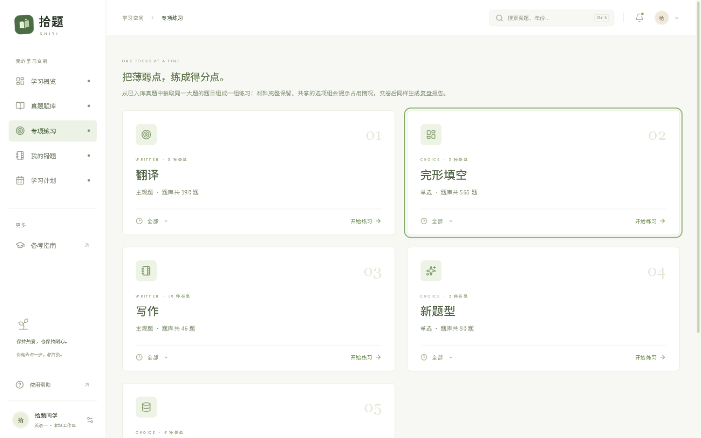

# 拾题 · Shiti Workbench

拾题(ShiTi Workbench) 是一款本地的考研英语练习平台。


## 现在能做什么

- 按年份找整卷练习，也可以按题型跨年份组专项；支持筛选、搜索和收藏。
- 作答会自动保存到本机工作区，训练中途可以暂停，之后接着做。
- 客观题按题目规则判分；翻译、写作等主观题不会被假装自动打分，会标为待评。
- 交卷后可以查看逐题报告，导出 Markdown 或 JSON；答错的客观题会收进错题本。
- 学习概览里有每日目标、日历、学习趋势和计划清单。

仓库目前附带 1986–2020 年英语（一）真题，共 35 份结构化试卷。专项练习会按题型从已有题库组卷：



## 本地运行

开发环境以 **Node.js 22 和 npm** 为准。在仓库根目录执行：

```bash
git clone https://github.com/AonoChano/ShiTi-Workbench.git
cd ShiTi-Workbench
npm ci
npm run dev
```

打开 <http://127.0.0.1:5173>。开发模式会同时启动网页和 API；第一次进入可以注册一个本地账号。

第一次启动会自动建好一个本机管理员账号，登录名是 `admin`（`admin@shiti.local` 只是占位邮箱，不能收信）。初始密码有两种给法：

- 自己指定：把 `.env.example` 复制为 `.env`，填写 `SHITI_ADMIN_PASSWORD` 后再启动，首次登录后可以删掉这一行。
- 让它生成：不设置时，服务会随机生成一个密码，写在数据目录的 `admin-credentials.txt` 里；登录后即可删除该文件。

没有邮件找回密码。忘记时在本机重置（新密码至少 8 位，且包含字母和数字）：

```bash
npm run reset-password -- admin MyNewPass123
```

`MyNewPass123` 只是示例，记得换成自己的密码。

生产构建和常用检查：

```bash
npm run build       # 构建 shared、server 和 web
npm start            # 本机启动生产版，打开 http://127.0.0.1:8210
npm run typecheck    # 三个 workspace 的 TypeScript 检查
npm test             # shared 与 server 测试
```

### 数据放在哪里

Windows 默认数据目录是 `%LOCALAPPDATA%\ShitiWorkbench\workspaces\default`，里面有 SQLite 数据库、报告和复盘文件。题库默认从仓库里的 `question_bank/` 读取。需要换目录或端口时，可在根目录 `.env` 中设置：

| 变量 | 用途 | 默认值 |
|---|---|---|
| `SHITI_DATA_DIR` | 练习数据目录 | Windows 的 `%LOCALAPPDATA%\ShitiWorkbench\workspaces\default` |
| `SHITI_BANK_DIR` | 题库目录 | 仓库根目录下的 `question_bank/` |
| `SHITI_PORT` | API 端口 | `8210` |
| `SHITI_ADMIN_PASSWORD` | 内置管理员账号（登录名 `admin`）的初始密码 | 未设置时随机生成，并写入数据目录 |

如果要备份练习数据，先停止服务，再复制整个数据目录。macOS 或 Linux 上运行时，建议显式设置 `SHITI_DATA_DIR`，不要沿用 Windows 默认路径。

## 用自己的题目

题库按 JSON 管理。格式和字段约定写在[英语一试卷规格](question_bank/NETEM_English_I/_规格说明.md)里；准备好文件后可以先校验：

```bash
npm run check-json -- question_bank/NETEM_English_I/2000.json
```

服务启动时会扫描题库，之后每 5 秒检查一次。通过校验的新文件会自动入库；修改后的文件也通过校验，才会生成新版本。已经开始的练习仍保留原来的题目快照。也可以在网页的题库管理里导入 JSON。

有些看图作文在 JSON 里引用了原图，但图片资源不随仓库提供；没有配置相应的本机图片目录时，这些图不会显示。

仓库内的英语真题仅供个人学习使用，不得商用或公开再分发；详细边界见[题库版权说明](question_bank/NETEM_English_I/_版权与使用说明.md)。

## 把复盘交给外部 Agent

交卷后，在报告页点「准备复盘目录」，拾题会在本机生成题目、作答和证据上下文，并放好 `AGENTS.md`、`CLAUDE.md` 和待填写的 `review.md`。让有权限访问该目录的本机 Agent 按说明编辑 `review.md`，拾题会读取有效更新并显示在报告页。原始答案和分数不会因此改变，Agent 给的建议也不会自动变成你的学习计划。

如果你用的是网页版 AI，可以自行导出 Markdown 再粘贴过去；这一步由你决定，内容会按所选服务的方式处理。文件格式和校验规则见[外部 Agent 文件协议](docs/05-外部Agent文件协议.md)。

## 本机服务

API 默认只监听本机 `127.0.0.1`。公开主页显示的仓库 Star 数来自 GitHub API；需要关闭时，在构建环境设置 `VITE_GITHUB_STARS_ENDPOINT=off`。

## 项目结构

```text
apps/web          React 前端
apps/server       Fastify API、本地 SQLite、题库扫描与复盘文件监听
packages/shared   前后端共用的导入校验、判分和报告逻辑
question_bank/    试卷 JSON
samples/          用于演示和测试的样本
scripts/          开发辅助脚本
```

技术栈：React 19、Vite 6、Fastify 5、TypeScript、better-sqlite3。

产品交互和数据约定放在 [`docs/`](docs/)；开发启动细节见 [`DEVELOPMENT.md`](DEVELOPMENT.md)，产品规划见 [`WHITEPAPER.md`](WHITEPAPER.md)。

## 许可证

软件代码采用 [MIT 许可证](LICENSE)。`question_bank/` 中的真题内容另有版权和使用限制，详见[题库版权说明](question_bank/NETEM_English_I/_版权与使用说明.md)。
